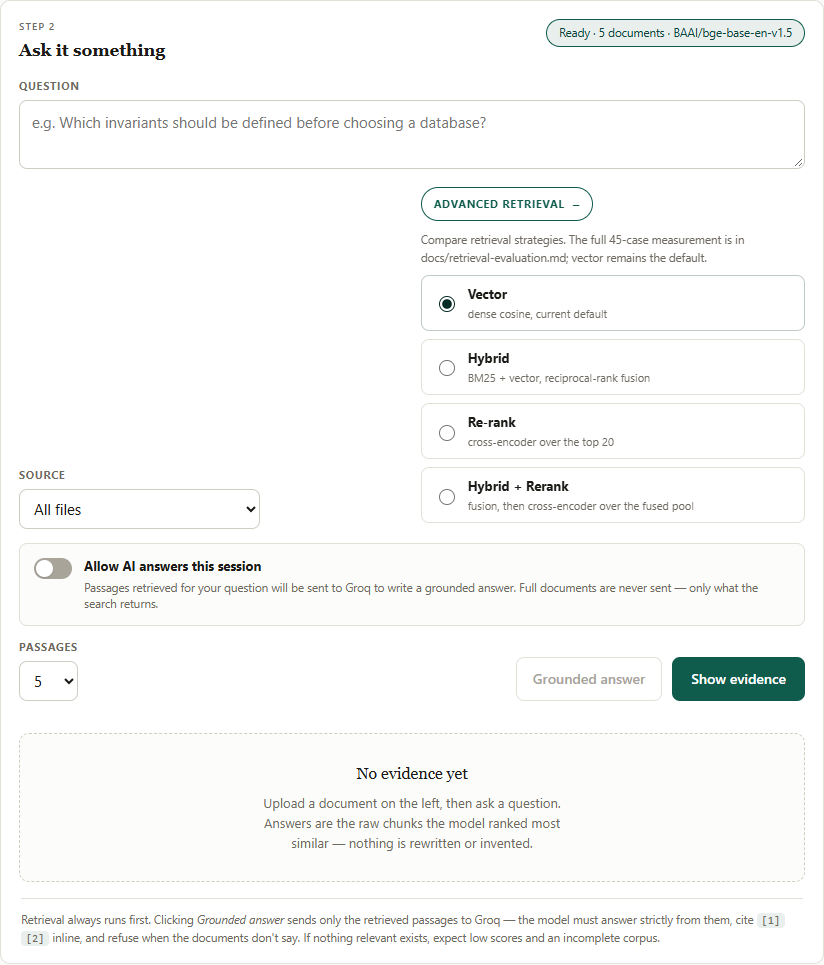
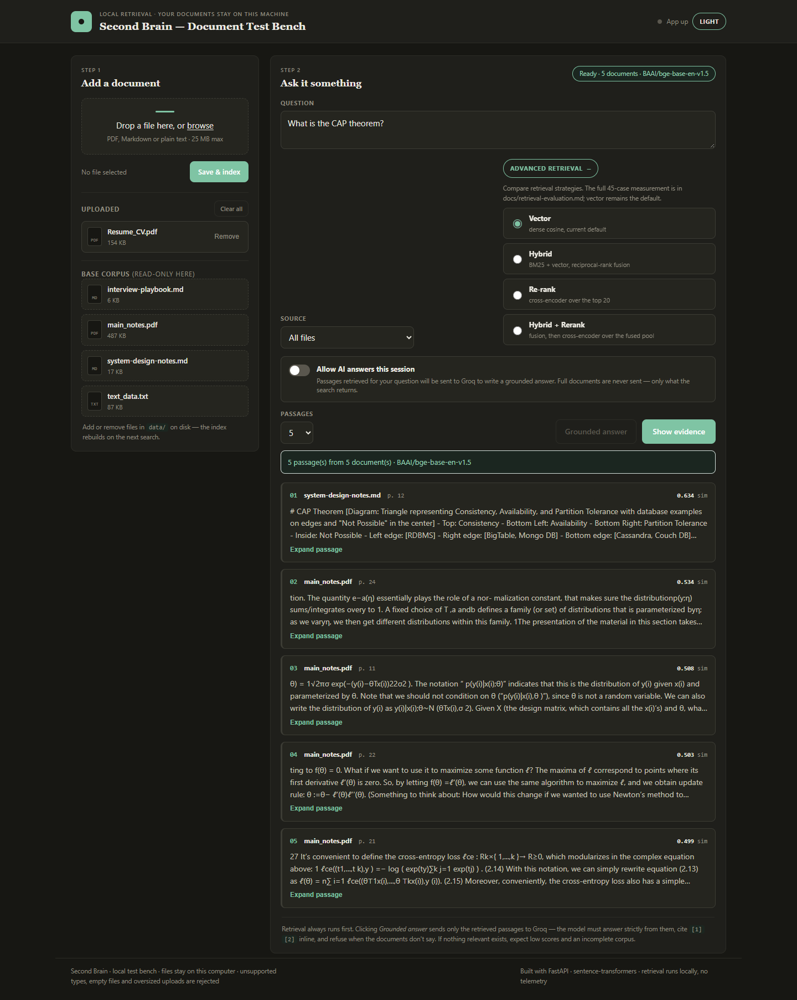

# Second Brain

Local retrieval over your own documents. Index PDFs, Markdown and text into
Qdrant, search them from the CLI or browser, and optionally generate answers
grounded in the retrieved passages. A separate script can OCR handwritten PDFs
with Gemini.

[](https://www.python.org/)
[](LICENSE)
[](https://github.com/basanta-codexa/RAG-second-brain-/actions/workflows/ci.yml)

## Setup

Requires Python 3.11+ and Docker.

```powershell
docker compose up -d
python -m venv venv
.\venv\Scripts\Activate.ps1
python -m pip install -r requirements.txt
python -m pip install -e . --no-deps
copy .env.example .env
python -m uvicorn app.main:app --reload
```

Open `http://127.0.0.1:8000` and upload a `.pdf`, `.md` or `.txt` file (25 MB
limit). CLI usage:

```powershell
python search.py --question "How does the cache fallback work?"
python search.py --rebuild
python evaluate.py --k 3
```

## Interface







Search returns ranked passages with source and page. **Details** on a file shows
page and chunk counts, SHA-256, duplicates, tags, processing status, a text
preview and, for PDFs, rendered page images. Tags and collections are local
metadata; the library can be filtered by collection. Answers are opt-in and
appear beside the evidence they used.

## How it works

Documents become page records, then overlapping sentence-aware chunks, which are
embedded with `BAAI/bge-base-en-v1.5` and stored in Qdrant. Files are hashed so
only new or changed files are re-embedded. State is written atomically, and a
file lock serializes syncs between the CLI, web app and evaluator.

See [docs/architecture.md](docs/architecture.md) for details.

## Chunking

`char` is the default: sentence-aware chunks measured in characters. `token`
uses the embedding model's tokenizer and keeps chunks within a token budget.

```powershell
python chunker.py --folder data --chunk-mode token --token-size 256 --token-overlap 48
python evaluate.py --k 3 --chunk-mode char --json char.json
python evaluate.py --k 3 --chunk-mode token --json token.json
```

Switching mode forces a full rebuild. An A/B run is recorded in
[docs/chunking-experiment.md](docs/chunking-experiment.md); `char` remains the
default.

## Retrieval modes

| Mode | Behavior |
| --- | --- |
| `vector` | Dense cosine search. Default. |
| `hybrid` | BM25 and vector scores fused with reciprocal rank fusion. |
| `rerank` | Cross-encoder reranking of the vector top 20. |
| `hybrid+rerank` | Fusion, then cross-encoder reranking of the fused pool. |

Source filters accept an origin (`data/notes.md`) or a filename (`notes.pdf`);
an unknown source returns `400`. Historical results are in
[docs/retrieval-evaluation.md](docs/retrieval-evaluation.md).

## Evaluation

```powershell
python evaluate.py --k 3
python evaluate.py --k 3 --hybrid
python evaluate.py --k 3 --rerank
python evaluate.py --k 3 --hybrid-rerank
python evaluate.py --k 3 --fail-under 0.8
```

| Metric | Definition |
| --- | --- |
| `hit@1` | Correct source and page ranked first. |
| `hit@k` | Correct source and page in the top *k*. |
| `MRR` | Mean reciprocal rank of the first correct result. |

Strict cases require the correct page in a multi-page source. `--fail-under`
gates on strict results when they exist. Missing source files are skipped and
reported. `--json report.json` writes a report with configuration, counts,
metrics, 95% confidence intervals, skips and misses.

## Configuration

Environment variables or a `.env` file in the project root. CLI flags override
them; the web app reads them at startup.

| Variable | Default | Purpose |
| --- | --- | --- |
| `SECOND_BRAIN_DATA` | `data` | Corpus directory |
| `SECOND_BRAIN_UPLOADS` | `uploads` | Upload directory |
| `SECOND_BRAIN_MODEL` | `BAAI/bge-base-en-v1.5` | Embedding model |
| `SECOND_BRAIN_RERANKER` | `cross-encoder/ms-marco-MiniLM-L-6-v2` | Reranker model |
| `SECOND_BRAIN_CHUNK_SIZE` | `800` | Chunk size, characters |
| `SECOND_BRAIN_OVERLAP` | `150` | Chunk overlap, characters |
| `SECOND_BRAIN_CHUNK_MODE` | `char` | `char` or `token` |
| `SECOND_BRAIN_TOKEN_SIZE` | `256` | Tokens per chunk in `token` mode |
| `SECOND_BRAIN_TOKEN_OVERLAP` | `48` | Token overlap in `token` mode |
| `SECOND_BRAIN_MAX_MB` | `25` | Upload limit |
| `SECOND_BRAIN_TAGS` | `.cache/document_tags.json` | Tag metadata file |
| `SECOND_BRAIN_COLLECTIONS` | `.cache/document_collections.json` | Collection metadata file |
| `SECOND_BRAIN_QDRANT` | `http://127.0.0.1:6333` | Qdrant endpoint |
| `SECOND_BRAIN_LOCK_TIMEOUT` | `600` | Sync lock wait, seconds |
| `GROQ_MODEL` | `openai/gpt-oss-120b` | Answer model |

Changing the model, chunk size or overlap triggers a full rebuild.

## Web API

Interactive docs are at `/docs` while the app is running.

| Method | Path | Purpose |
| --- | --- | --- |
| `GET` | `/api/status` | Corpus, sources, model, upload limit |
| `GET` | `/api/documents/{folder}/{name}` | Document details |
| `GET` | `/api/documents/{folder}/{name}/pages/{page}` | PDF page as PNG |
| `PUT` | `/api/documents/{folder}/{name}/tags` | Replace tags |
| `PUT` | `/api/documents/{folder}/{name}/collection` | Set or clear collection |
| `GET` | `/api/index-status` | Indexing progress |
| `POST` | `/api/upload` | Upload one or more files |
| `DELETE` | `/api/uploads/{name}` | Remove an upload |
| `POST` | `/api/uploads/clear` | Remove all uploads |
| `POST` | `/api/search` | Retrieve passages |
| `POST` | `/api/answer` | Generate an answer (requires consent) |

A web request waits up to 5 seconds for a sync held by another process, then
returns `409` with `Retry-After: 5`.

## Privacy and security

Documents, chunks and index state stay on this machine. Three exceptions:

- The first run downloads the embedding model, and rerank modes download a
  cross-encoder, from Hugging Face.
- `transcribe.py` sends rendered page images to Gemini when OCR is used.
- `/api/answer` sends retrieved passages to Groq after consent is enabled.

Recent questions live only in browser `localStorage`; the **Clear** button
removes them. `docker-compose.yml` disables Qdrant telemetry and binds its REST
port to `127.0.0.1`. The web app has no authentication and binds to localhost;
do not expose either service without adding authentication.

Generated answers are not factually verified. The UI flags out-of-range citation
numbers and sentences with little word overlap with their cited passages. That
overlap check is a heuristic, not proof of support.

## Tests

```powershell
python -m pip install -r requirements-test.txt
python -m pytest
python -m ruff check .
```

Tests use in-memory Qdrant and fake encoders, so they need no Docker or model
downloads. Conventions are in [CONTRIBUTING.md](CONTRIBUTING.md).

## Layout

```text
app/              FastAPI service, UI, answer generation
tests/            pytest suite
docs/             architecture and evaluations
data/             corpus (gitignored)
uploads/          web uploads (gitignored)
transcripts/      OCR page cache (gitignored)
loader.py         documents -> page records
chunker.py        page records -> chunks
qdrant_store.py   collection lifecycle, plan, state
metadata.py       local tags and collections
search.py         embedding, retrieval, CLI
evaluate.py       retrieval metrics
transcribe.py     handwritten PDF -> Markdown
testset.py        retrieval test cases
```

`pip install -e .` adds `second-brain-search` and `second-brain-evaluate`.

## Limitations

- PDF text extraction varies with layout; tables, equations and scans may need
  OCR or cleanup.
- Deleting an upload purges its vectors immediately; changes in `data/` are
  applied on the next search.
- The index cache keys on file size and mtime; restoring files with preserved
  timestamps needs a rebuild.
- Markdown pages need `<<<PAGE n>>>` markers; without them a file is page 1.
- `data/` and `transcripts/` are gitignored, so a fresh clone has no corpus and
  evaluation numbers depend on your documents.

## License

MIT. See [LICENSE](LICENSE).
