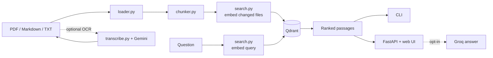

# Second Brain

<p>
  
  
  
  
</p>

A local retrieval-augmented generation (RAG) tool for personal documents. It
indexes PDFs, Markdown, and text files in Qdrant, retrieves relevant passages,
and can generate cited answers with Groq. An optional Gemini script transcribes
handwritten PDFs first.

> Documents, chunks, and index state stay on this machine. Network calls happen
> only for optional OCR and generated answers.

## At a glance

| Area | Implementation |
| --- | --- |
| Interface | CLI and local FastAPI web UI |
| Storage | Qdrant vector database |
| Embeddings | `sentence-transformers`, `BAAI/bge-base-en-v1.5` by default |
| Retrieval | Vector search, BM25 hybrid, cross-encoder reranking |
| Answers | Optional Groq generation with citation checks |
| OCR | Optional Gemini transcription for scanned PDFs |

## Architecture



Indexing is incremental. Each file is content-hashed, only new or changed files
are embedded, and stale point IDs are removed after replacements are written.

## Requirements

- Python 3.11+
- Docker, for Qdrant
- Optional: `GROQ_API_KEY` for generated answers
- Optional: `GEMINI_API_KEY` for PDF transcription

## Setup

Start Qdrant:

```powershell
docker run -d --name second-brain-qdrant --restart unless-stopped `
  -p 6333:6333 -p 6334:6334 `
  -v "${env:USERPROFILE}\.qdrant\storage:/qdrant/storage" qdrant/qdrant
```

If the container already exists:

```powershell
docker start second-brain-qdrant
```

Create the environment and install dependencies:

```powershell
python -m venv venv
.\venv\Scripts\Activate.ps1
python -m pip install -r requirements.txt
python -m pip install -r requirements-test.txt
copy .env.example .env
```

Fill in the keys you need in `.env`. The web app and `transcribe.py` load that
file automatically.

## Usage

Search the corpus:

```powershell
python search.py
python search.py --question "How does the cache fallback work?"
python search.py --rebuild
```

Inspect chunks:

```powershell
python chunker.py
python inspect_chunks.py find "cap theorem"
```

Transcribe a handwritten PDF:

```powershell
python transcribe.py --pdf system-design-notes.pdf
```

The transcription is resumable. Pages are cached under `transcripts/`.

Run the web app:

```powershell
python -m uvicorn app.main:app --reload
```

Open `http://127.0.0.1:8000`. The app accepts `.pdf`, `.md`, and `.txt` uploads
up to 25 MB by default. The index updates on the next query.

### Retrieval modes

| Mode | Behavior |
| --- | --- |
| `vector` | Dense cosine search; default |
| `hybrid` | BM25 plus vector results merged with reciprocal rank fusion |
| `rerank` | Cross-encoder reranking of vector candidates |

Source filters accept an origin such as `data/notes.md` or a filename such as
`notes.pdf`.

## Evaluation

```powershell
python evaluate.py --k 3
python evaluate.py --k 3 --hybrid
python evaluate.py --k 3 --rerank
python evaluate.py --k 3 --fail-under 0.8
```

| Metric | Meaning |
| --- | --- |
| `hit@1` | Expected source/page ranked first |
| `hit@k` | Expected source/page present in the top *k* |
| `MRR` | Mean reciprocal rank of the first correct result |

Results are split into strict and lenient subsets. Strict tests require the
correct page in a multi-page source; lenient tests accept any page or come from
a single-page source. `--fail-under` exits non-zero for CI.

## Configuration

| Variable | Default | Purpose |
| --- | --- | --- |
| `SECOND_BRAIN_DATA` | `data` | Base corpus directory |
| `SECOND_BRAIN_UPLOADS` | `uploads` | Web upload directory |
| `SECOND_BRAIN_MODEL` | `BAAI/bge-base-en-v1.5` | Embedding model |
| `SECOND_BRAIN_MAX_MB` | `25` | Maximum upload size |
| `SECOND_BRAIN_CHUNK_SIZE` | `800` | Chunk size in characters |
| `SECOND_BRAIN_OVERLAP` | `150` | Chunk overlap in characters |
| `SECOND_BRAIN_QDRANT` | `http://127.0.0.1:6333` | Qdrant URL |
| `GROQ_MODEL` | `openai/gpt-oss-120b` | Answer model |

## Project structure

```text
.
├── app/                 FastAPI service and browser UI
├── tests/               pytest suite
├── data/                base corpus (gitignored)
├── uploads/             web uploads (gitignored)
├── transcripts/         OCR page cache (gitignored)
├── loader.py            PDF/Markdown/text -> page records
├── chunker.py           page records -> sentence-aware chunks
├── qdrant_store.py      collection lifecycle, filters, and index state
├── search.py            embedding, retrieval, hybrid search, reranking
├── evaluate.py          hit@1 / hit@k / MRR
├── transcribe.py        handwritten PDF -> Markdown
└── testset.py           retrieval test cases
```

Qdrant state is stored in `.cache/qdrant_state.json`. A change to the embedding
model, chunk configuration, or collection layout triggers a full rebuild.

## Web API

| Method | Path | Purpose |
| --- | --- | --- |
| `GET` | `/api/status` | Corpus, sources, model, and upload limit |
| `GET` | `/api/index-status` | Live indexing progress |
| `POST` | `/api/upload` | Upload one document |
| `DELETE` | `/api/uploads/<name>` | Remove one upload |
| `POST` | `/api/uploads/clear` | Remove all uploads |
| `POST` | `/api/search` | Retrieve passages |
| `POST` | `/api/answer` | Generate an answer; requires session consent |

## Privacy and security

Documents stay local. The two exceptions are explicit:

- `transcribe.py` sends page images to Google Gemini.
- Generated answers send retrieved passages to Groq after you enable AI answers
  for the session.

The web app has no authentication and is intended for local use only. Do not
expose it to a network. Generated answers are not verified for factual
correctness; treat them as drafts.

## Tests

```powershell
python -m pytest
python -m ruff check .
```

The test suite uses an in-memory Qdrant client and a fake encoder, so it does
not need Docker or a downloaded model.

## Limitations

- PDF extraction quality depends on the source layout. Tables, math, and scans
  may need OCR or manual cleanup.
- The web app caches the index by file size and modification time. After
  restoring files with preserved timestamps, restart the server or run
  `python search.py --rebuild`.
- If Qdrant storage is removed while the web app is running, restart the app so
  its index cache notices the missing collection.
- Markdown page numbers require `<<<PAGE n>>>` markers. Without them, the file
  is treated as page 1 for evaluation.
- No license is provided.
