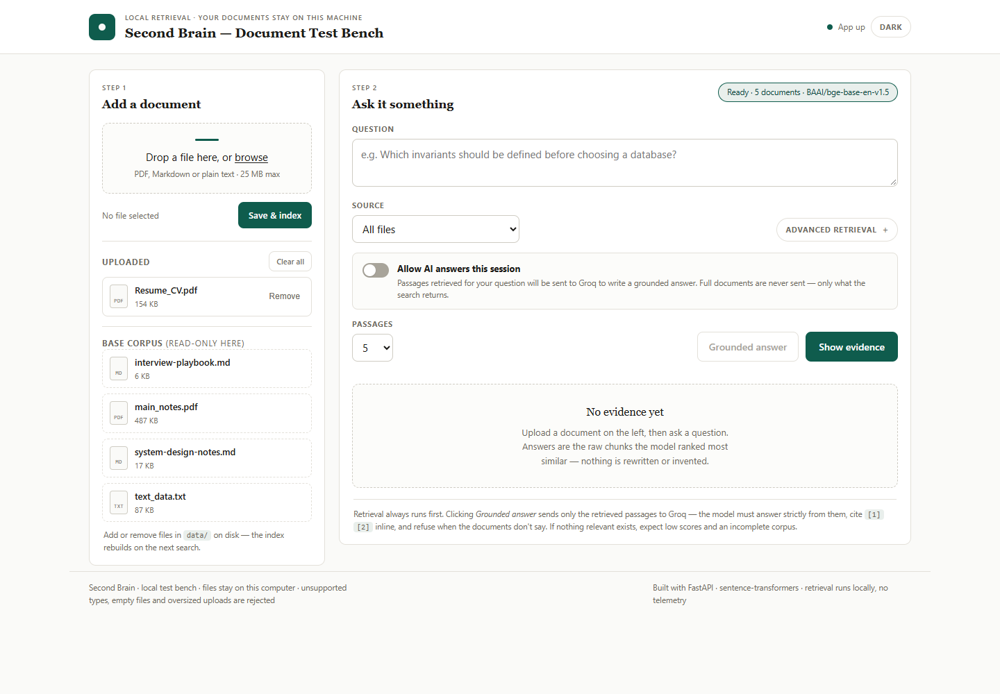
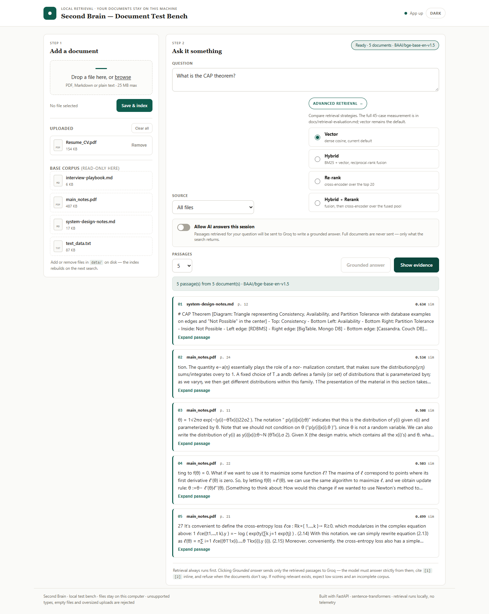
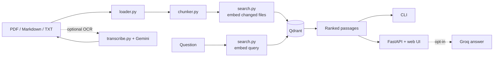

# Second Brain

Local retrieval over personal documents. Index PDFs, Markdown, and text into
Qdrant, search them from a CLI or browser, and optionally generate answers that
cite the passages they used. A separate script transcribes handwritten PDFs
through Gemini before indexing.

[](https://www.python.org/)
[](LICENSE)
[](https://github.com/basanta-codexa/RAG-second-brain-/actions/workflows/ci.yml)

## Quick start

Requires Python 3.11+ and Docker.

```powershell
docker compose up -d
python -m venv venv
.\venv\Scripts\Activate.ps1
python -m pip install -r requirements.txt
python -m pip install -r requirements-test.txt
python -m pip install -e . --no-deps
copy .env.example .env
python -m uvicorn app.main:app --reload
```

Open `http://127.0.0.1:8000` and upload a `.pdf`, `.md`, or `.txt` file. The app
accepts files up to 25 MB. Qdrant starts with telemetry disabled; see
[Privacy](#privacy-and-security) for the other network calls.

Command line:

```powershell
python search.py --question "How does the cache fallback work?"
python search.py --rebuild
python evaluate.py --k 3
```

## Interface

The workbench shows the corpus and the question form. You can drop several
files at once. Search returns ranked passages with source and page. Click
**Details** on any file to see its page
and chunk counts, SHA-256, byte-identical duplicates, index status and a short
extracted-text preview. No answer is generated unless the consent switch is
enabled. When one is generated, the answer and its supporting passages appear
side by side; citation chips jump to the matching passage. Recent questions
appear as chips you can click to run again.



Advanced options expose the four retrieval modes described below.


Ranked passages for a question about the CAP theorem.



The same view in dark mode.


## How it works

Documents are loaded as page records, split into overlapping sentence-aware
chunks, embedded with `BAAI/bge-base-en-v1.5`, and written to Qdrant. Each file
is hashed; only new or changed files are re-embedded. Deletions of old point IDs
happen after replacements are in place, and the state file is written
atomically.



Details are in [docs/architecture.md](docs/architecture.md).

## Chunking experiments

Two chunkers are available. `char` (default) is sentence-aware and counts
characters; `token` uses the embedding model's tokenizer so chunks stay within
a token budget and never cut mid-token.

```powershell
python chunker.py --folder data --chunk-mode char --show 3
python chunker.py --folder data --chunk-mode token --token-size 256 --token-overlap 48
python evaluate.py --k 3 --chunk-mode char --json char.json
python evaluate.py --k 3 --chunk-mode token --json token.json
```

Switching mode changes the index signature and forces a full rebuild; results
from the previous mode are not comparable until you re-run the evaluator. The
historical numbers in `docs/retrieval-evaluation.md` were measured with `char`.
A first A/B run is recorded in [docs/chunking-experiment.md](docs/chunking-experiment.md);
`char` won on strict accuracy, so it remains the default.

## Retrieval modes

| Mode | Behavior |
| --- | --- |
| `vector` | Dense cosine search in Qdrant. Default. |
| `hybrid` | BM25 and vector scores fused by reciprocal rank fusion. |
| `rerank` | Cross-encoder reranking of the vector top 20. |
| `hybrid+rerank` | Fusion first, then cross-encoder reranking of the fused pool. |

The default is `vector`. On the author's local corpus (not shipped) it scored
19/22 on strict hit@1 and answered in 47 ms; `hybrid+rerank` scored 15/22 at
roughly 1.1 s. Treat these as historical measurements: the corpus has since
changed, and a fresh clone must re-run `evaluate.py` on its own documents. The
full comparison, including two reranker models, is in
[docs/retrieval-evaluation.md](docs/retrieval-evaluation.md).

Hybrid modes score against a BM25 index and vector matrix built once per index
sync, so queries do not pull the whole corpus over HTTP. Scoring is still
O(corpus) per query: about 1.5 ms for 3,000 chunks at 768 dimensions on the
author's machine.

Source filters take either an origin (`data/notes.md`) or a filename
(`notes.pdf`); an unknown source returns `400`.

## Evaluation

```powershell
python evaluate.py --k 3
python evaluate.py --k 3 --hybrid
python evaluate.py --k 3 --rerank
python evaluate.py --k 3 --hybrid-rerank
python evaluate.py --k 3 --fail-under 0.8
```

`--fail-under` checks the strict subset when one exists. Strict cases require
the correct page in a multi-page source; lenient cases accept any page from the
source or come from a single-page source. `--json report.json` writes a
machine-readable report with the configuration, counts, metrics (including
95% Wilson confidence intervals for hit@k), skips and misses. Save it alongside
results so runs can be compared.

| Metric | Definition |
| --- | --- |
| `hit@1` | Correct source and page ranked first. |
| `hit@k` | Correct source and page in the top *k*. |
| `MRR` | Mean reciprocal rank of the first correct result. |

Cases whose source file is missing are skipped and printed, not counted as
passes.

## Configuration

Read from the environment or a `.env` file in the project root.

| Variable | Default | Purpose |
| --- | --- | --- |
| `SECOND_BRAIN_DATA` | `data` | Corpus directory |
| `SECOND_BRAIN_UPLOADS` | `uploads` | Upload directory |
| `SECOND_BRAIN_MODEL` | `BAAI/bge-base-en-v1.5` | Embedding model |
| `SECOND_BRAIN_RERANKER` | `cross-encoder/ms-marco-MiniLM-L-6-v2` | Reranker model |
| `SECOND_BRAIN_CHUNK_SIZE` | `800` | Chunk size, characters |
| `SECOND_BRAIN_OVERLAP` | `150` | Chunk overlap, characters |
| `SECOND_BRAIN_CHUNK_MODE` | `char` | `char` or `token` chunking |
| `SECOND_BRAIN_TOKEN_SIZE` | `256` | Tokens per chunk in `token` mode |
| `SECOND_BRAIN_TOKEN_OVERLAP` | `48` | Token overlap in `token` mode |
| `SECOND_BRAIN_MAX_MB` | `25` | Upload limit |
| `SECOND_BRAIN_QDRANT` | `http://127.0.0.1:6333` | Qdrant endpoint |
| `SECOND_BRAIN_LOCK_TIMEOUT` | `600` | Seconds to wait for another index sync |
| `GROQ_MODEL` | `openai/gpt-oss-120b` | Answer model |

CLI flags override these values; the web app reads them at startup. Changing
the embedding model, chunk size, or overlap invalidates the index and triggers
a full rebuild.

## Web API

Interactive documentation is served at `/docs` while the app is running.

| Method | Path | Purpose |
| --- | --- | --- |
| `GET` | `/api/status` | Corpus, sources, model, upload limit |
| `GET` | `/api/documents/{folder}/{name}` | Inspect one document: pages, chunks, preview |
| `GET` | `/api/index-status` | Indexing progress |
| `POST` | `/api/upload` | Upload one or more documents |
| `DELETE` | `/api/uploads/{name}` | Remove one upload |
| `POST` | `/api/uploads/clear` | Remove all uploads |
| `POST` | `/api/search` | Retrieve passages |
| `POST` | `/api/answer` | Generate an answer (requires consent) |

Index syncs are serialized across processes. If the CLI or another process is
syncing, a web request waits up to 5 seconds, then returns `409` with
`Retry-After: 5`.

## Privacy and security

Documents, chunks, and index state stay on this machine. Three exceptions:

- The first run downloads the embedding model, and rerank modes download a
  cross-encoder, from Hugging Face.
- `transcribe.py` sends rendered page images to Gemini when OCR is used.
- `/api/answer` sends retrieved passages to Groq after the UI's consent switch
  is enabled.

Recent questions are kept only in this browser's `localStorage`; the **Clear**
button removes them. They are never sent to the server or a provider.

`docker-compose.yml` sets `QDRANT__TELEMETRY_DISABLED=true` and binds Qdrant's
REST port to `127.0.0.1`. The web app has no authentication and binds to
localhost; do not expose either service to a network unless you add
authentication. Generated answers are not factually verified. The UI flags
out-of-range citation numbers and sentences with little word overlap with their
cited passages; that overlap check is a heuristic, not proof of support.

## Tests

```powershell
python -m pytest
python -m ruff check .
```

Tests use in-memory Qdrant and fake encoders, so they need neither Docker nor
downloaded models. Development conventions are in [CONTRIBUTING.md](CONTRIBUTING.md).

## Project layout

```text
app/          FastAPI service, UI, answer generation
tests/        pytest suite
docs/         architecture and evaluation results
data/         corpus (gitignored)
uploads/      web uploads (gitignored)
transcripts/  OCR page cache (gitignored)
loader.py     documents -> page records
chunker.py    page records -> chunks
qdrant_store.py  collection lifecycle, index plan, state
search.py     embedding, retrieval, CLI
evaluate.py   retrieval metrics
transcribe.py  handwritten PDF -> Markdown
testset.py    retrieval test cases
```

`pip install -e .` adds `second-brain-search` and `second-brain-evaluate`.

## Limitations

- PDF text extraction varies with layout; tables, equations, and scans may need
  OCR or manual cleanup.
- Deleting an upload purges its vectors immediately. Adding or removing files in
  `data/` is applied on the next search.
- The web index cache keys on file size and mtime. Restoring files with
  preserved timestamps needs a rebuild.
- Removing Qdrant storage while the app runs requires an app restart.
- Markdown page numbers require `<<<PAGE n>>>` markers; without them the file is
  treated as page 1.
- `data/` and `transcripts/` are local and gitignored. A fresh clone has no
  corpus, so evaluation numbers depend on the documents you add.

## License

MIT. See [LICENSE](LICENSE).
