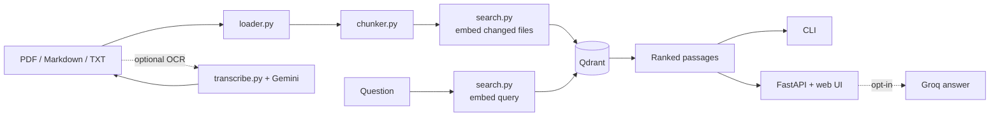

# Architecture

Second Brain is a single-process indexing and retrieval pipeline. Qdrant holds
vectors and payloads; a JSON file records which file hashes produced which point
IDs. The web app holds one index in memory and refreshes it when the corpus
changes.

## Components

| File | Responsibility |
| --- | --- |
| `loader.py` | PDF, Markdown, and text to page records; `<<<PAGE n>>>` markers |
| `chunker.py` | Overlapping, sentence-aware chunks with stable IDs |
| `qdrant_store.py` | Collection lifecycle, incremental plan, filters, state file |
| `search.py` | Embedding, retrieval modes, RRF fusion, reranking, CLI |
| `app/main.py` | FastAPI routes, uploads, index cache, locking, static UI |
| `app/generate.py` | Grounded answers, citation checks, refusal handling |
| `evaluate.py` | hit@1, hit@k, MRR over strict and lenient cases |
| `transcribe.py` | Resumable Gemini OCR of handwritten PDFs |

## Indexing

`qdrant_store.plan()` is pure. Its inputs are current file hashes, the saved
state, an index signature, and whether the collection exists. Its outputs are
the files to embed, the point IDs to drop, and a rebuild flag. The signature
includes the schema version, embedding model, chunk size, and overlap, so a
configuration change forces a rebuild rather than mixing vector spaces.

The write sequence in `search.create_index()` is ordered for crash safety:

1. Delete points belonging to files that no longer exist.
2. Upsert new and changed files.
3. Delete their old point IDs, excluding IDs that were just overwritten.
4. Persist state with a temp file and atomic replace.

A rebuild clears the state file before dropping the collection, so an aborted
or crashed rebuild is retried in full instead of leaving stale point ids that
would convince the next sync to skip repairs. A file that fails to read or
embed keeps its old points and state entry; the next sync retries it.
`StoreUnavailable` aborts the sync before the final state is saved. This
ordering is covered by tests in `tests/test_index_sync.py`.

## Retrieval

| Mode | Path |
| --- | --- |
| `vector` | Cosine search in Qdrant |
| `hybrid` | BM25 and vector scores fused with RRF |
| `rerank` | Cross-encoder over the vector top 20 |
| `hybrid+rerank` | Fusion, then cross-encoder over the fused pool |

The BM25 index and vector matrix for hybrid modes are built once per index sync
and stored on the cached index dict. A query scores in-process instead of
fetching every vector and payload from Qdrant. Per-source views are cached
separately so IDF is computed over the rows actually searched.

The web app keeps one index per process. Its cache key is the corpus directory
token (name, size, mtime for each file), model, and chunk configuration. A sync
that reports file errors is not cached, so the next request retries it.
`state_lock` serializes index syncs with uploads, deletes, and clears, so a
query cannot observe a directory mid-update. Upload deletes and clears also
purge the matching Qdrant points by origin before unlinking the files, so a
deleted upload's chunks do not linger until the next sync.

## Configuration

Environment variables, with a `.env` file loaded explicitly by the web app and
the transcription script. See the README for the full list. Model loading is
lazy, so importing the package never downloads weights.

## Design limits

- Hybrid scoring is in-process and O(corpus). Measured at roughly 1.5 ms for
  3,000 chunks; larger corpora need Qdrant-side sparse vectors.
- The directory token uses file size and mtime. Restoring files with preserved
  timestamps requires `--rebuild`.
- The web app has no authentication and binds to localhost.
- Citation checks detect out-of-range reference numbers only; answers are not
  factually verified.
- The evaluation document uses 26 of 39 transcribed pages, covering every page
  in the test set.

Measured results are in [retrieval-evaluation.md](retrieval-evaluation.md).
